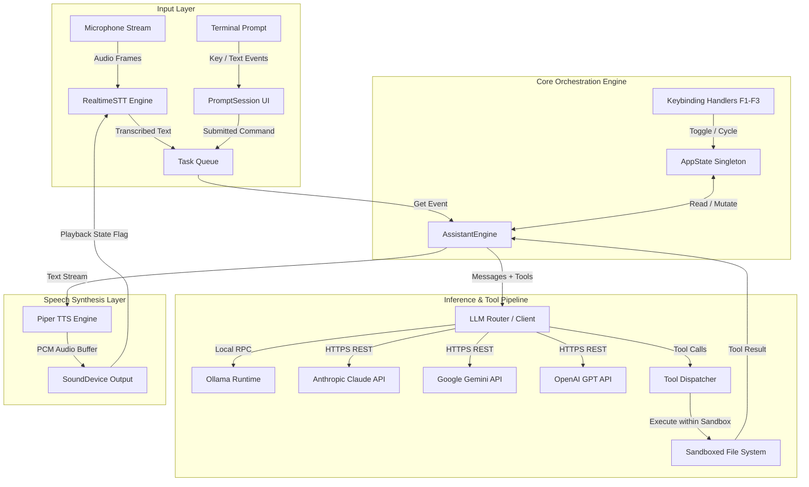
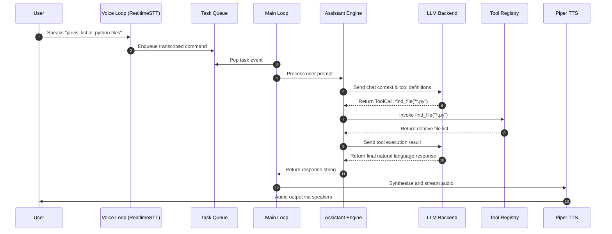

# System Architecture

Jarvis is a modular, event-driven, voice-first AI workstation assistant with sandboxed file system capabilities. It operates locally using Ollama and Piper TTS, while supporting dynamic fallback to cloud LLM backends (Anthropic Claude, Google Gemini, OpenAI GPT).

---

## High-Level System Design

The architecture is partitioned into four primary layers:

1. **Input & Capture Layer:** Asynchronous text prompt ingestion (`prompt_toolkit`) and real-time wake-word audio streaming (`RealtimeSTT`).
2. **Orchestration & State Layer:** Core engine managing thread-safe application state, model cycling, and multi-turn message history.
3. **Inference & Execution Layer:** LLM provider abstraction and iterative function execution pipeline.
4. **Speech Output Layer:** Local low-latency multilingual speech synthesis via Piper TTS and PortAudio.

---

## Concurrency & Threading Model

Jarvis enforces non-blocking concurrent execution using dedicated threads communicating through thread-safe queues and atomic synchronization primitives:

| Thread                   | Role                                                             | Communication Channel           | Blocking Behavior      |
| :----------------------- | :--------------------------------------------------------------- | :------------------------------ | :--------------------- |
| **Main Thread**          | Event loop, Engine execution, Tool calling, Audio playback       | `task_queue.get(timeout=0.2)`   | Non-blocking poll      |
| **CLI Input Thread**     | Terminal line editing and global key handling (`prompt_toolkit`) | Writes to `task_queue`          | Blocking on user input |
| **Voice Capture Thread** | Audio recording, VAD, and Whisper STT inference                  | Writes to `task_queue`          | Continuous poll        |
| **Playback Sync**        | Prevents microphone feedback loop during speech output           | `threading.Event (is_speaking)` | Shared flag            |

