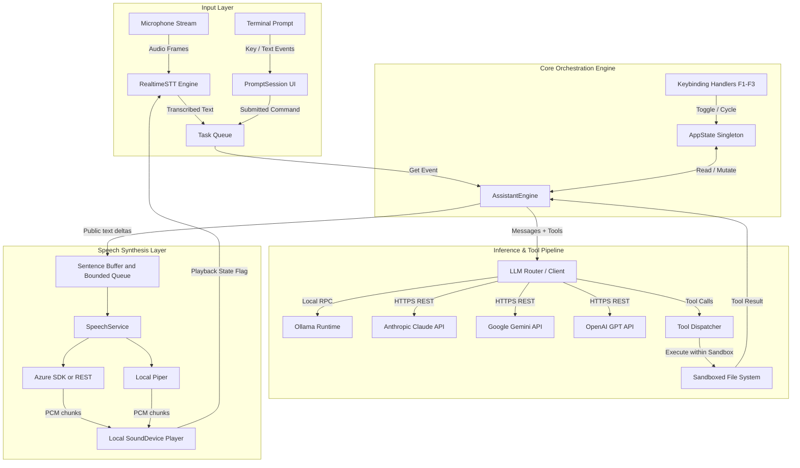
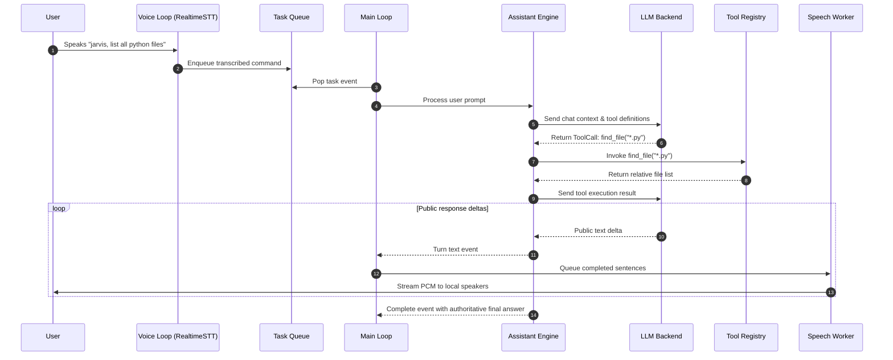

# System Architecture

Jarvis is a modular, event-driven, voice-first AI workstation assistant with sandboxed file system capabilities. It operates locally using Ollama and Piper TTS, while supporting dynamic fallback to cloud LLM backends (Anthropic Claude, Google Gemini, OpenAI GPT).

---

## High-Level System Design

The architecture is partitioned into four primary layers:

1. **Input & Capture Layer:** Asynchronous text prompt ingestion (`prompt_toolkit`) and real-time wake-word audio streaming (`RealtimeSTT`).
2. **Orchestration & State Layer:** Core engine managing thread-safe application state, model cycling, and multi-turn message history.
3. **Inference & Execution Layer:** LLM provider abstraction and iterative function execution pipeline.
4. **Speech Output Layer:** Bounded sentence buffering, Azure SDK/REST or local Piper synthesis, and a separate client-side PCM player. See [Speech Output](SPEECH.md) for configuration and fallback policy.

---

## Concurrency & Threading Model

Input and speech use dedicated threads. The main thread consumes engine events and executes synchronous tools. A separate bounded speech queue keeps playback from blocking text generation:

| Thread                   | Role                                                             | Communication Channel              | Blocking Behavior                                           |
| :----------------------- | :--------------------------------------------------------------- | :--------------------------------- | :---------------------------------------------------------- |
| **Main Thread**          | Engine event consumption, tool calling, terminal output          | `task_queue.get()` and LLM streams | Blocking reads; audio runs separately                       |
| **Speech Worker**        | Sentence normalization, synthesis, PCM playback                  | Bounded sentence queue             | Blocking synthesis/playback; cancellable between operations |
| **CLI Input Thread**     | Terminal line editing and global key handling (`prompt_toolkit`) | Writes to `task_queue`             | Blocking on user input                                      |
| **Voice Capture Thread** | Audio recording, VAD, and Whisper STT inference                  | Writes to `task_queue`             | Continuous poll                                             |
| **Playback Sync**        | Prevents microphone feedback loop during speech output           | `threading.Event (is_speaking)`    | Shared flag                                                 |

