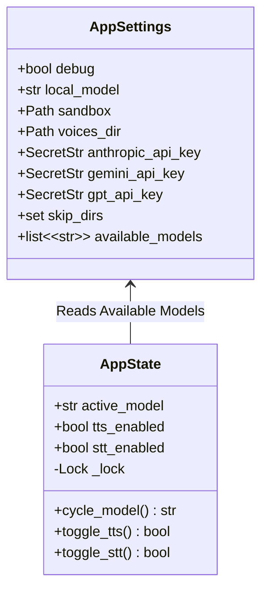
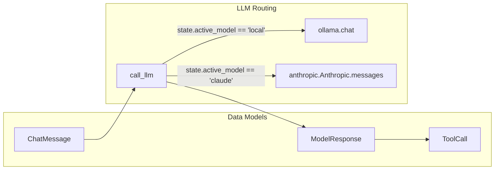

# Component Reference

This document outlines the internal modules, their responsibilities, and how they interact across the codebase.

---

## 1. Core Module (`jarvis.core`)

Responsible for environment resolution, structured logging, and runtime global state.

- **`config.py`**: Declares `AppSettings` utilizing `pydantic-settings`. Automatically loads `.env` values prefixed with `JARVIS_` and dynamically verifies which LLM providers have valid credentials.
- **`logging.py`**: Initializes `Loguru` handlers. Directs colored logs to `sys.stderr` and structured diagnostic output to rotating log files in `./logs/`.
- **`state.py`**: Houses `AppState`, maintaining atomic state transitions across worker threads using mutex locking (`threading.Lock`).

---

## 2. Speech Processing Module (`jarvis.speech`)

Handles acoustic input capture, local speech-to-text, and local or cloud speech synthesis.

### Text-to-Speech (`jarvis.speech.tts`)

- **Providers:** Optional Azure Speech SDK, Azure REST, and lazy local Piper. `SpeechService` controls fallback and cooldowns without opening a speaker.
- **Language:** Explicit per-turn locale and configurable voice maps; no character-based guessing.
- **Output:** `SpeechOutput` queues completed sentences and streams raw PCM through a separate lazy player. Queue overload or speech failure leaves text generation running.
- **Acoustic Feedback Prevention:** The local `is_speaking` event drops STT transcriptions during playback. Voice interruption is not implemented.
- See [Speech Output](SPEECH.md) for module boundaries, configuration, and cancellation.

### Speech-to-Text (`jarvis.speech.stt`)

- **Engine:** `RealtimeSTT` with `faster-whisper` running locally on CPU (`int8` quantization).
- **Wake Word:** Continuously monitors audio buffers for `"jarvis"` with configurable sensitivity.

---

## 3. LLM Abstraction Layer (`jarvis.llm`)

Abstracts heterogeneous model providers behind a unified schema and execution interface.

- **`schemas.py`**: Pydantic models (`ChatMessage`, `ToolCall`, `ModelResponse`) normalizing request and response structures across Ollama and cloud APIs.
- **`prompts.py`**: Holds `SYSTEM_PROMPT`, enforcing assistant personality, sandbox constraints, and operational guidelines.
- **`client.py`**: `stream_llm()` emits public text deltas and a fully assembled message for Ollama, Anthropic, and OpenAI-compatible providers. Tool payloads are assembled before parsing; abnormal tool completion is rejected. `call_llm()` remains a compatibility consumer.
- **`engine.py`**: `handle_stream()` emits text, tool lifecycle, and terminal events, with the backend fixed for the turn. `handle()` still returns the final answer and turn ID.
- **`runtime.py`**: Routes engine events to a text consumer and optional local speech output.

---

## 4. Tool Registry & Sandbox (`jarvis.tools`)

Provides tools exposed to the LLM agent while enforcing sandbox boundary constraints.

- **`path.py`**: Implements `safe_path()` to ensure all paths stay within the configured sandbox root.
- **`fs.py`**: File system operations (`get_time`, `find_file`, `read_file`, `list_dir`, `edit_file`, `create_file`, `delete_file`, `create_directory`).
- **`registry.py`**: Aggregates exposed functions into `AVAILABLE_TOOLS` and maps them in `TOOL_REGISTRY`.

---

## 5. UI & Interaction Layer (`jarvis.ui`)

- **`keybindings.py`**: Attaches key handlers to the active `PromptSession`:
  - **`F1`**: Cycles between enabled models (`local` -> `claude` -> `gemini` -> `gpt`).
  - **`F2`**: Toggles microphone capture on/off.
  - **`F3`**: Toggles voice synthesis; muting cancels current speech.
  - **`F4`**: Requests reply cancellation. Running synchronous tools cannot be rolled back.
