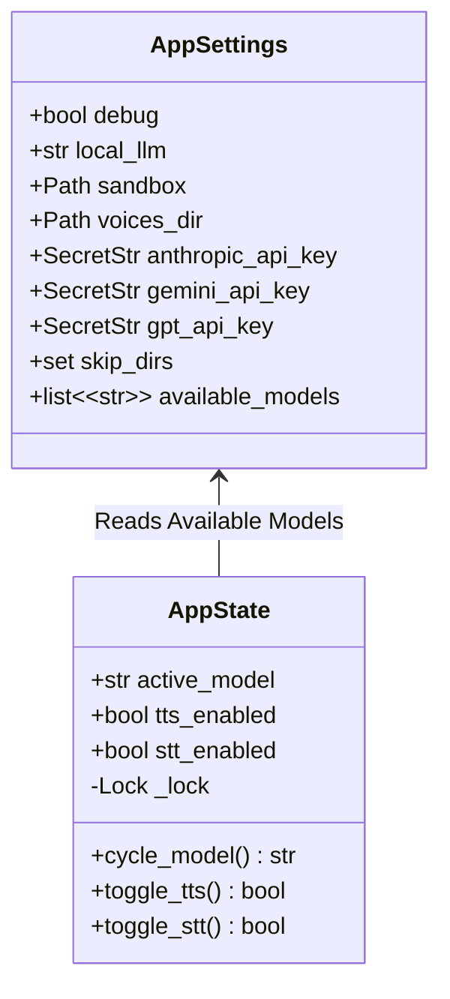
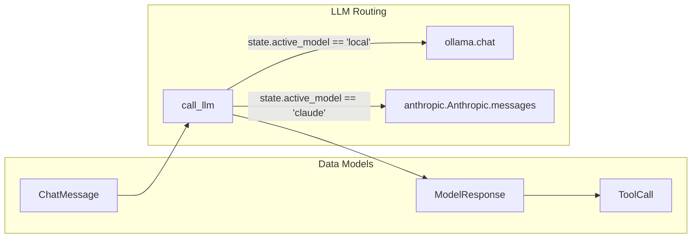

# Component Reference

This document outlines the internal modules, their responsibilities, and how they interact across the codebase.

---

## 1. Core Module (`jarvis.core`)

Responsible for environment resolution, structured logging, and runtime global state.

- **`config.py`**: Declares `AppSettings` utilizing `pydantic-settings`. Automatically loads `.env` values prefixed with `JARVIS_` and dynamically verifies which LLM providers have valid credentials.
- **`logging.py`**: Initializes `Loguru` handlers. Directs colored logs to `sys.stderr` and structured diagnostic output to rotating log files in `./logs/`.
- **`state.py`**: Houses `AppState`, maintaining atomic state transitions across worker threads using mutex locking (`threading.Lock`).

---

## 2. Speech Processing Module (`jarvis.speech`)

Handles acoustic input capture, local speech-to-text, and local text-to-speech synthesis.

### Text-to-Speech (`jarvis.speech.tts`)

- **Engine:** Piper TTS (`piper-tts`) loaded from local ONNX models.
- **Language Detection:** Uses regular expressions to match Cyrillic (`ru`), Polish diacritics (`pl`), or English (`en`) character sets to select the appropriate voice model.
- **Acoustic Feedback Prevention:** Flags the `is_speaking` thread event to pause STT processing during active playback.

### Speech-to-Text (`jarvis.speech.stt`)

- **Engine:** `RealtimeSTT` with `faster-whisper` running locally on CPU (`int8` quantization).
- **Wake Word:** Continuously monitors audio buffers for `"jarvis"` with configurable sensitivity.

---

## 3. LLM Abstraction Layer (`jarvis.llm`)

Abstracts heterogeneous model providers behind a unified schema and execution interface.

- **`schemas.py`**: Pydantic models (`ChatMessage`, `ToolCall`, `ModelResponse`) normalizing request and response structures across Ollama and cloud APIs.
- **`prompts.py`**: Holds `SYSTEM_PROMPT`, enforcing assistant personality, sandbox constraints, and operational guidelines.
- **`client.py`**: Dispatches requests to the backend defined by `state.active_model`.

---

## 4. Tool Registry & Sandbox (`jarvis.tools`)

Provides tools exposed to the LLM agent while enforcing sandbox boundary constraints.

- **`path.py`**: Implements `safe_path()` to ensure all paths stay within the configured sandbox root.
- **`fs.py`**: File system operations (`get_time`, `find_file`, `read_file`, `list_dir`, `edit_file`, `create_file`, `delete_file`, `create_directory`).
- **`registry.py`**: Aggregates exposed functions into `AVAILABLE_TOOLS` and maps them in `TOOL_REGISTRY`.

---

## 5. UI & Interaction Layer (`jarvis.ui`)

- **`keybindings.py`**: Attaches key handlers to the active `PromptSession`:
  - **`F1`**: Cycles between enabled models (`local` -> `claude` -> `gemini` -> `gpt`).
  - **`F2`**: Toggles microphone capture on/off.
  - **`F3`**: Toggles voice synthesis on/off.
