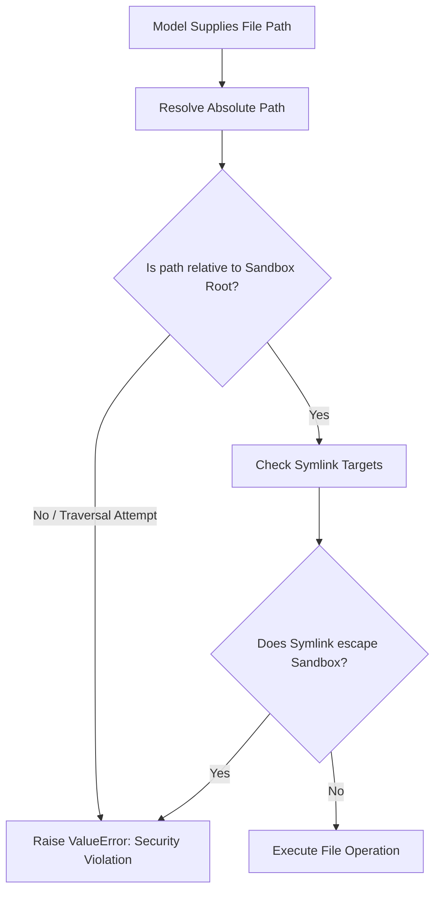

# Sandbox Security & File System Isolation

Jarvis enforces strict security controls to prevent unintended host system modifications or directory traversal attacks.

---

## Security Model

All file system operations executed by the agent must reside strictly within the directory defined by `JARVIS_SANDBOX` (defaults to `./sandbox`).

---

## Path Normalization Rules

The path validator `safe_path()` enforces the following rules:

1. **Relative Resolution:** Relative paths (e.g., `src/main.py`) are resolved against `settings.sandbox.resolve()`.
2. **Absolute Resolution:** Absolute paths provided by the model are normalized via `Path.resolve()` and tested against the sandbox boundary using `Path.is_relative_to()`.
3. **Directory Traversal Defense:** Paths containing `..` or leading `/` that attempt to escape the sandbox root raise a `ValueError` immediately.

---

## Tool Execution Matrix

| Tool Name          | Parameters                                | Allowed Target      | Safety Checks                                               |
| :----------------- | :---------------------------------------- | :------------------ | :---------------------------------------------------------- |
| `find_file`        | `file_name: str`                          | Sandbox tree        | Skips ignored directories (`.git`, `.venv`, `node_modules`) |
| `read_file`        | `path: str`                               | Existing files      | Verified via `safe_path()` and `is_file()`                  |
| `edit_file`        | `path: str, old_text: str, new_text: str` | Existing files      | Requires exact single match of `old_text`                   |
| `create_file`      | `path: str, content: str`                 | New files           | Parent directory creation; fails if file already exists     |
| `delete_file`      | `path: str`                               | Existing files      | `safe_path()` check; restricted to files only               |
| `create_directory` | `path: str`                               | New directory paths | Recursive creation with `exist_ok=False` guard              |
