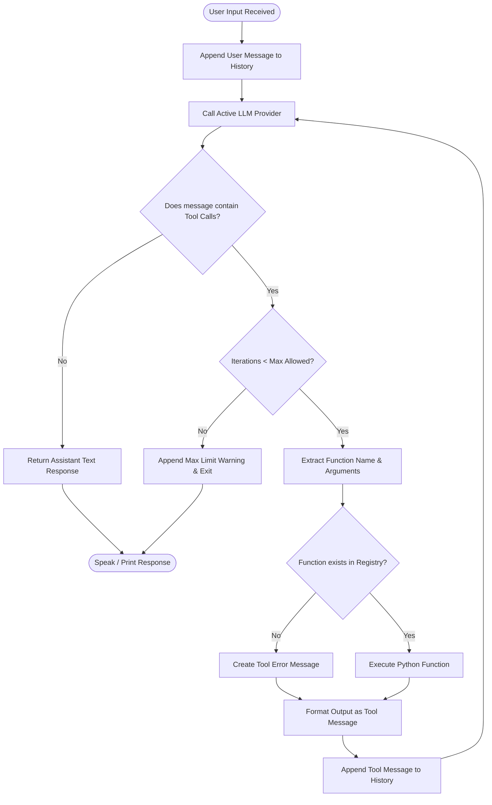
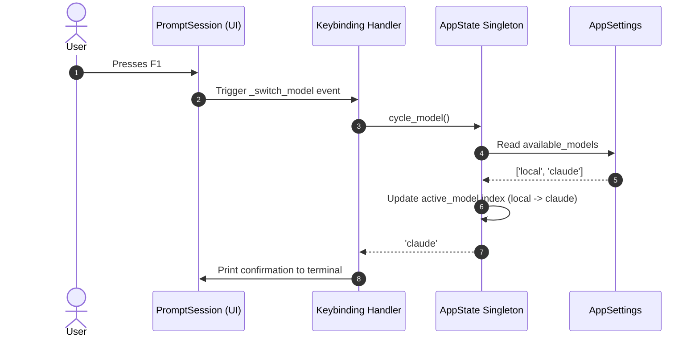
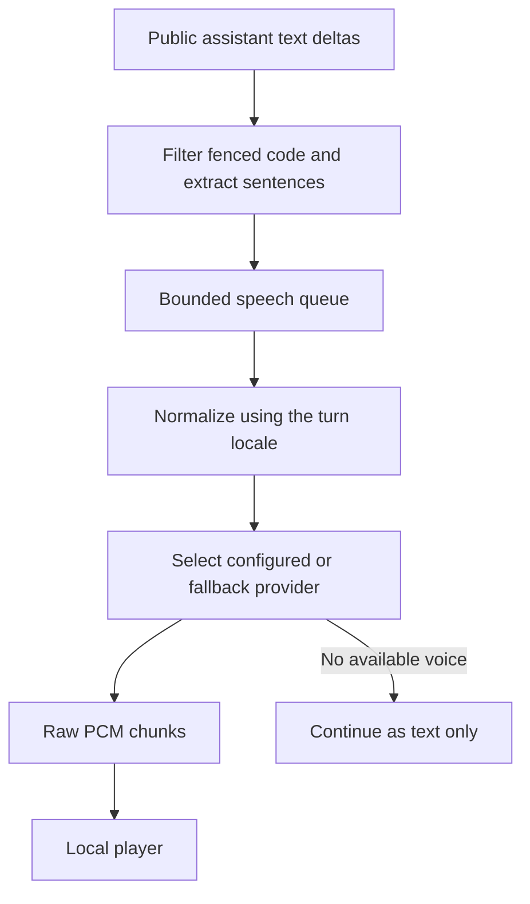

# Operational Workflows

This document outlines key runtime workflows within Jarvis.

---

## 1. Agent Tool Calling Loop

When a user requests a file system action, the engine executes an iterative dialogue loop until the model delivers a final natural language answer.

---

## 2. Dynamic Backend Switching Workflow

The user can cycle active LLM backends at runtime using the `F1` keybinding without restarting the assistant.

---

## 3. Multilingual Speech Synthesis Pipeline

Each response uses an explicit locale. Public text is displayed immediately and
buffered into sentences for a bounded speech worker. Azure SDK/REST and Piper
share a synthesis contract; playback remains separate.

Fallback is allowed only before the response's first audio is delivered. A later
failure stops speech rather than replaying earlier text. Muting or F4 cancellation
never selects another provider. See [Speech Output](SPEECH.md) for configuration
and the exact failure/cancellation policy.
