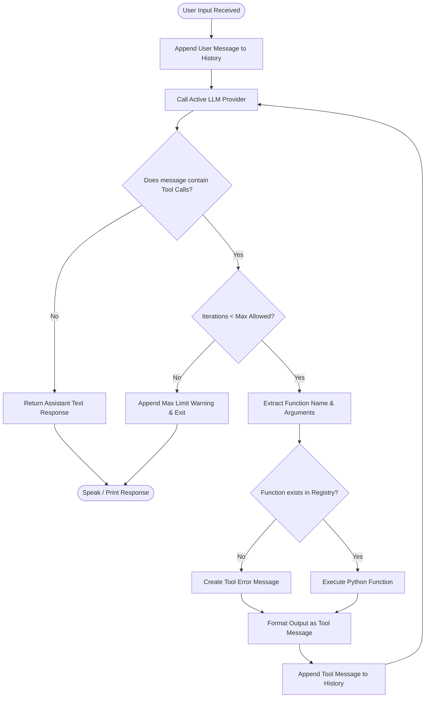
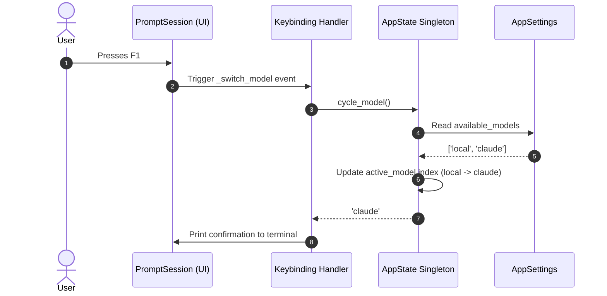
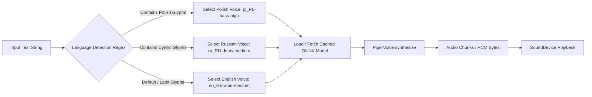

# Operational Workflows

This document outlines key runtime workflows within Jarvis.

---

## 1. Agent Tool Calling Loop

When a user requests a file system action, the engine executes an iterative dialogue loop until the model delivers a final natural language answer.

---

## 2. Dynamic Backend Switching Workflow

The user can cycle active LLM backends at runtime using the `F1` keybinding without restarting the assistant.

---

## 3. Multilingual Speech Synthesis Pipeline

Incoming text responses are analyzed for character scripts before selecting the appropriate Piper TTS voice model.

